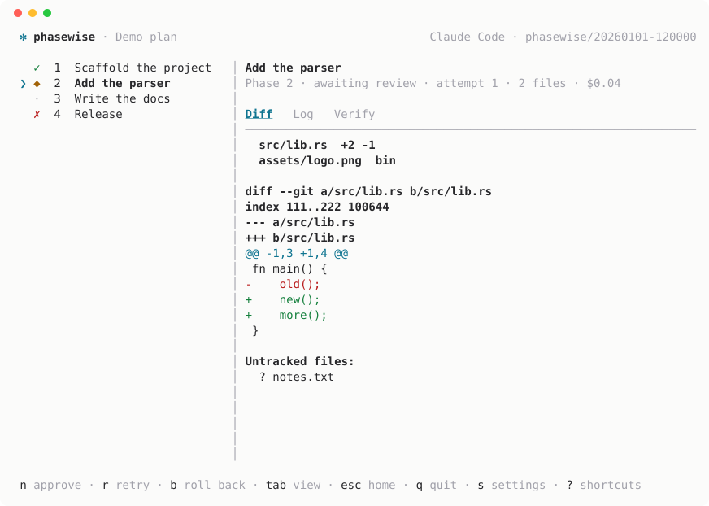

<div align="center">
  <picture>
    <source media="(prefers-color-scheme: dark) and (max-width: 900px)" srcset="assets/readme/card-narrow-dark.svg">
    <source media="(max-width: 900px)" srcset="assets/readme/card-narrow-light.svg">
    <source media="(prefers-color-scheme: dark)" srcset="assets/readme/card-wide-dark.svg">
    
  </picture>
</div>

<p align="center">
  <a href="#quick-start">Quick start</a> ·
  <a href="docs/user-guide.md">User guide</a> ·
  <a href="SECURITY.md">Security</a>
</p>

<p align="center">
  <a href="https://github.com/userfypp/phasewise/actions/workflows/ci.yml"></a>
  <a href="https://crates.io/crates/phasewise"></a>
  <a href="LICENSE"></a>
</p>

<picture>
  <source media="(prefers-color-scheme: dark)" srcset="assets/readme/home-dark.svg">
  
</picture>

phasewise runs a Markdown plan with Claude Code or Codex, one phase at a time. The agent works on a single phase, your checks prove it, a git commit saves it, and nothing continues until you have looked at it.

Hand an agent a big plan in one go and you get one enormous change to review, with no safe point to return to when step 7 breaks step 3. Here every phase is a commit on a branch of its own: you can read it, retry it with a note, or roll back to it. Your own branch stays untouched until you decide to merge.

## How a run works

<picture>
  <source media="(prefers-color-scheme: dark) and (max-width: 900px)" srcset="assets/readme/run-graph-narrow-dark.svg">
  <source media="(max-width: 900px)" srcset="assets/readme/run-graph-narrow-light.svg">
  <source media="(prefers-color-scheme: dark)" srcset="assets/readme/run-graph-wide-dark.svg">
  
</picture>

1. You describe what you want in a sentence. The agent reads your project, without changing it, and writes `phasewise.md`. Or you write the plan yourself.
2. Each phase runs headless on the branch `phasewise/<run-id>`, and then your checks run. If one fails, the agent gets its output and tries again.
3. You read the diff, the agent's log and the checks, then approve the phase, retry it with a note, or roll back.
4. When the last phase is approved, you merge the run branch into yours with `phasewise merge` (or `m` on the run screen), or by hand with the command phasewise prints.

<picture>
  <source media="(prefers-color-scheme: dark)" srcset="assets/readme/run-dark.svg">
  
</picture>

## What you get

- A plan the agent drafts: it explores the project read-only, then writes phases small enough to review, each with checks taken from your build files.
- A fresh session for every phase: the agent sees that phase's instructions and a one-line summary of the phases already done, nothing else.
- Checks that decide: your own commands, such as `cargo test` or `npm run lint`, run after every phase. If one fails, the agent gets the output and another try while retries remain.
- Checkpoints you can return to: each phase is a commit with `Phasewise-Run` and `Phasewise-Phase` trailers.
- A model for each job: the planner picks the model and effort of every phase, cheap for mechanical work and strong for hard work. Change any of them in the plan or from the home screen.
- Claude Code or Codex: the same plan runs on either, and one key switches between them.

## Quick start

You need git, macOS or Linux, and Claude Code or Codex installed and logged in. Installing from source needs [Rust](https://rustup.rs) 1.88 or later.

```sh
cargo install phasewise       # or: cargo install --git https://github.com/userfypp/phasewise
cd your-project
phasewise
```

Press `p` and describe what you want. Read the plan the agent writes, press `c` to commit it and `enter` to start. After each phase, `n` approves it and runs the next one, `r` retries it with a note, `b` rolls back, and `esc` goes back to the home screen.

Every step is also a command: `phasewise plan "…"`, `phasewise run`, `phasewise next` and `phasewise status`. The [user guide](docs/user-guide.md) covers the screens, plans, models, every command and what to do when a phase fails.

## Good to know

- The agent works without permission prompts, as your user and with your environment. The run branch protects your history, not your machine: read [Security](SECURITY.md) before running a plan you did not write.
- phasewise merges a run only when you ask with `merge` or `m`. It never pushes, never deletes branches and makes no network connections of its own. It has no telemetry and never will.
- Agents cost money. phasewise shows Claude Code's cost per phase; Codex does not report one.
- Tested with Claude Code 2.1.325 and Codex CLI 0.160.0. Agent CLIs change often, so [Agents](docs/agents.md) lists the exact command lines phasewise uses.
- Windows is not supported.

## Documentation

- [User guide](docs/user-guide.md): the screens, every command, models and effort, and what to do when something goes wrong.
- [Plan format](docs/plan-format.md): the Markdown file phasewise reads, with its validation errors explained.
- [Agents](docs/agents.md): the command lines and output formats of Claude Code and Codex.
- [Architecture](docs/ARCHITECTURE.md): modules, data flow, files on disk and invariants.
- [Roadmap](docs/ROADMAP.md): what may come.
- [Releasing](docs/RELEASING.md): how versions and releases are made.
- [Contributing](CONTRIBUTING.md), [Security](SECURITY.md), [Code of conduct](CODE_OF_CONDUCT.md) and [Changelog](CHANGELOG.md).

<p align="center"><sub>MIT licensed · © userfypp</sub></p>
